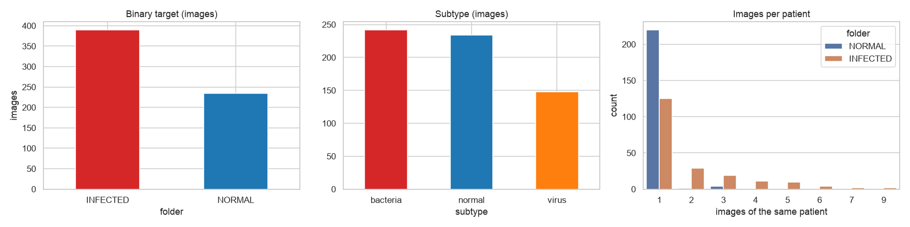
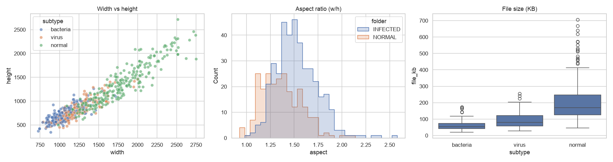
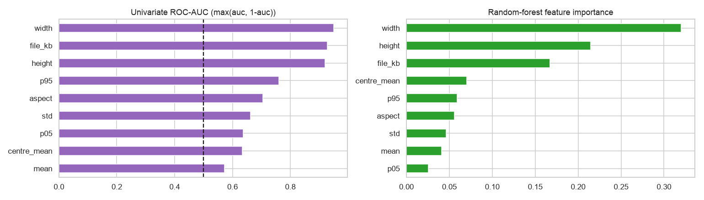
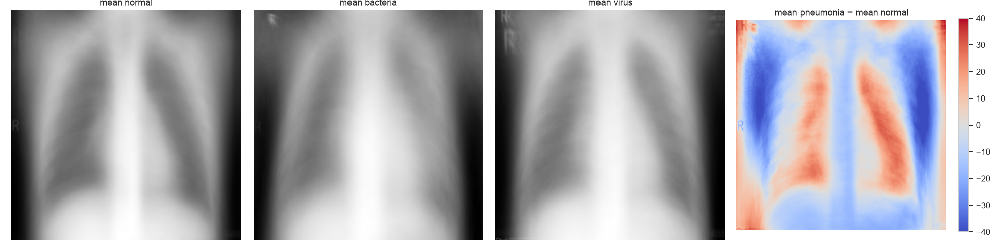
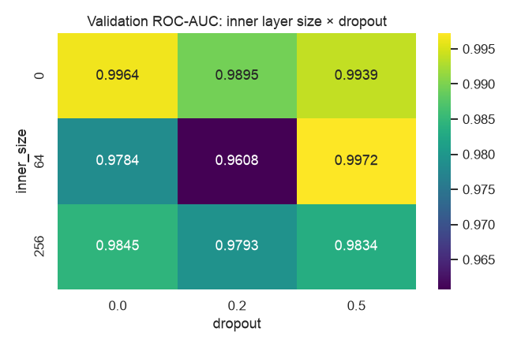
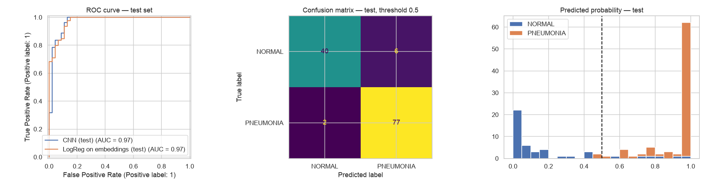
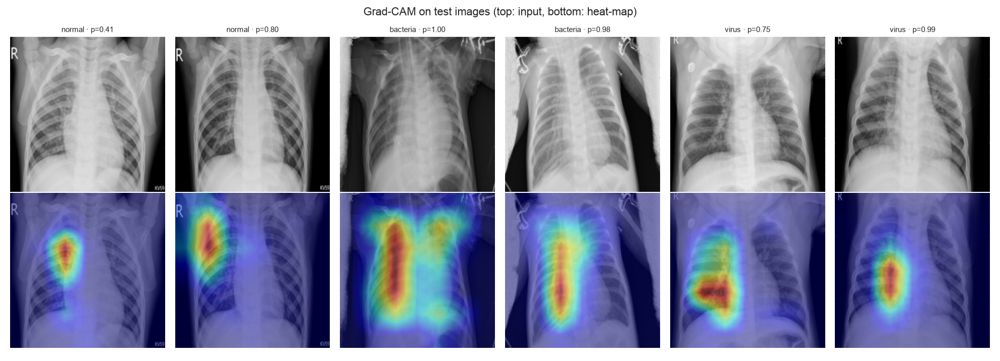
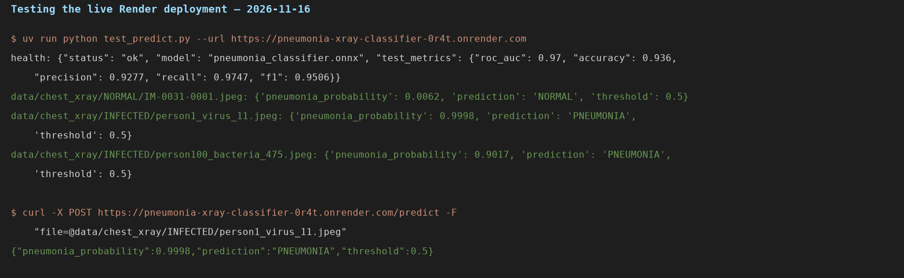

# Pneumonia Detection from Pediatric Chest X-rays

**ML Zoomcamp 2026 — Midterm project**

A deep-learning web service that classifies a pediatric chest X-ray as **NORMAL** or **PNEUMONIA**. The model is a fine-tuned MobileNetV3 trained in PyTorch, exported to ONNX and served with FastAPI in a Docker container, which is deployed on Render.

**Live demo:** https://pneumonia-xray-classifier-0r4t.onrender.com (upload page) · https://pneumonia-xray-classifier-0r4t.onrender.com/docs (Swagger UI)
> The service runs on Render's free tier, which sleeps when idle. The first request can take ~30–60 s.


---

## Table of contents

1. [Problem description](#1-problem-description)
2. [Dataset](#2-dataset)
3. [EDA highlights](#3-eda-highlights)
4. [Modelling and results](#4-modelling-and-results)
5. [Project structure](#5-project-structure)
6. [How to run it](#6-how-to-run-it): environment, notebook, training, local service, Docker
7. [Using the API](#7-using-the-api)
8. [Cloud deployment (Render)](#8-cloud-deployment-render)
9. [Limitations and next steps](#9-limitations-and-next-steps)

---

## 1. Problem description

**Pneumonia** is the leading infectious cause of death in children under five, killing over 700,000 children a year (WHO). A chest X-ray is the standard way to confirm it, but reading X-rays needs a trained radiologist. In many hospitals, and especially in low-resource settings, radiologists are scarce, and X-rays can wait hours before anyone reads them.

**Goal:** build a model that looks at a pediatric chest X-ray and estimates the probability of pneumonia, and expose it as a web service.

**How the solution would be used:** as a **triage / second-reader tool**, not a diagnosis.

* A hospital PACS or a clinician uploads the X-ray to the `/predict` endpoint as soon as it is taken.
* The service returns `P(pneumonia)` and a label. Images flagged as PNEUMONIA move to the top of the radiologist's worklist, so likely-sick children are seen first.
* Because a **missed pneumonia (false negative) is much costlier than a false alarm**, the model is selected by ROC-AUC. The decision threshold is then tuned for **high recall (F2 score)**.

This is a **binary image classification** problem. Input: one grayscale chest X-ray of any size. Output: probability of pneumonia (bacterial or viral).

## 2. Dataset

* **Source:** a 624-image subset of *Chest X-Ray Images (Pneumonia)*. Kermany, Zhang & Goldbaum (2018), *Labeled Optical Coherence Tomography (OCT) and Chest X-Ray Images for Classification*, Mendeley Data, v2, [doi:10.17632/rscbjbr9sj.2](https://data.mendeley.com/datasets/rscbjbr9sj/2) (CC BY 4.0). The full dataset is also on [Kaggle](https://www.kaggle.com/datasets/paultimothymooney/chest-xray-pneumonia). The images are anterior-posterior chest X-rays of children aged 1–5 from Guangzhou Women and Children's Medical Center.
* **The data is committed to this repo** in `data/chest_xray/` (77 MB), so no download is needed:

  ```
  data/chest_xray/
  ├── NORMAL/     234 images   e.g. IM-0031-0001.jpeg, NORMAL2-IM-0272-0001.jpeg
  └── INFECTED/   390 images   e.g. person100_bacteria_475.jpeg (242 bacterial), person1_virus_11.jpeg (148 viral)
  ```

* File names encode the **patient ID** (`person100`, `IM-0031`, …) and the **pneumonia subtype** (bacteria / virus). Both are used in the analysis.

## 3. EDA highlights

The full analysis is in [`notebook.ipynb`](notebook.ipynb), section 2.

| | |
|---|---|
|  | **Target:** 62.5 % pneumonia / 37.5 % normal (moderately imbalanced; handled with a class-weighted loss). 202 patients have pneumonia and 225 are healthy, and some patients have several images, so **the split is done by patient** to avoid leakage. No missing values and no exact duplicate files. |
|  | **Image sizes vary widely (≈ 400–2900 px)** and all images are grayscale. Normal images are much larger and higher-resolution than pneumonia images. |
|  | **Shortcut / leakage check.** Simple global features show that **image width alone separates the classes with ROC-AUC ≈ 0.95**. That is an acquisition artefact, not a disease signal. All images are therefore resized to 224×224, so absolute size is not available to the CNN. Aspect ratio (AUC ≈ 0.70) still leaks a little, which we discuss in [limitations](#9-limitations-and-next-steps). |
|  | **Content:** the difference map is brighter (red) over both lung fields in pneumonia images. That is consistent with consolidation and infiltrates, and it is the signal we want the model to use. The blue lateral bands show another framing difference between the sources. |

More plots in the notebook: sample grids per subtype, pixel-intensity histograms, and brightness of the central lung region.

## 4. Modelling and results

All models use the same **patient-level, subtype-stratified 60/20/20 split** (375 train / 124 val / 125 test images, seed 42, saved in `reports/split.csv`).

### 4.1 Classical baselines: linear and tree-based (validation ROC-AUC)

| Features | Logistic regression (tuned `C`) | Random forest (tuned `n_estimators`, `max_depth`, `min_samples_leaf`) |
|---|---|---|
| Raw pixels, 32×32 | 0.951 (`C=1`) | 0.943 (`n=300,depth=None,leaf=5`) |
| Frozen MobileNetV3 ImageNet embeddings (960-d) | 0.977 (`C=0.01`) | 0.978 (`n=100,depth=None,leaf=5`) |

### 4.2 CNN transfer learning (PyTorch)

Architecture: ImageNet-pre-trained backbone → global average pooling → [optional dense inner layer + ReLU] → [optional dropout] → 1 logit. Training uses AdamW, a cosine LR schedule, class-weighted BCE, augmentation (small rotations, shifts, zoom, brightness/contrast), and early stopping on validation ROC-AUC.

The tuning was done in stages. All 17 runs are in [`reports/experiments.csv`](reports/experiments.csv).

| Stage | Tried | Best (val ROC-AUC) |
|---|---|---|
| 1. Backbone | MobileNetV3-Large, EfficientNet-B0, ResNet-18 (fine-tuned), MobileNetV3 frozen | **MobileNetV3-Large, fine-tuned: 0.996** (EfficientNet-B0 0.988, ResNet-18 0.985, frozen MobileNetV3 0.914) |
| 2. Learning rate | 1e-4, 3e-4, 1e-3 | **3e-4: 0.996** (1e-4: 0.983, 1e-3: 0.989) |
| 3. Head | inner layer size {none, 64, 256} × dropout {0, 0.2, 0.5} | **inner 64 + dropout 0.5: 0.997** (no inner layer: 0.996; inner layers without dropout overfit after 1–2 epochs) |
| 4. Augmentation | on / off | **on: 0.997** (off: 0.983, overfits after 1 epoch) |



### 4.3 Final model, held-out test set

**Final configuration:** MobileNetV3-Large (fine-tuned), lr 3e-4, inner layer 64, dropout 0.5, augmentation on. Decision threshold **0.5**, chosen by F2 on validation.

| Metric (test, 125 images) | Value |
|---|---|
| ROC-AUC | 0.970 |
| Accuracy | 0.936 |
| Recall (sensitivity) | **0.975** (77 / 79 pneumonia cases caught) |
| Precision | 0.928 |
| F1 | 0.951 |



**Grad-CAM** shows the model mostly looks at the lung fields:



**Error analysis:** bacterial pneumonia is recognised perfectly (49/49). The 2 missed cases are viral pneumonia (28/30 caught), which is subtler on X-rays. The other 6 errors are false alarms on normal images (40/46 correct), which is the acceptable direction for triage.

**Honest comparison:** on the test set the CNN's ROC-AUC (0.97) is about the same as the strong *frozen-embeddings + logistic regression* baseline, although the CNN was clearly better on validation. With 125 test images the difference between strong models is small. The CNN was kept, following the selection rule fixed in advance (best validation ROC-AUC), and because it gives one self-contained ONNX model for deployment.

## 5. Project structure

```
├── README.md
├── notebook.ipynb          # data prep, EDA, baselines, CNN experiments & tuning, evaluation, Grad-CAM
├── common.py               # shared code: data catalogue, patient split, preprocessing, model, training loop
├── train.py                # trains the final model -> models/pneumonia_classifier.onnx + metadata.json
├── predict.py              # FastAPI web service (ONNX Runtime, no PyTorch at inference time)
├── test_predict.py         # client: sends images to a running service (local or cloud)
├── tests/test_api.py       # pytest tests for the API
├── data/chest_xray/        # dataset (committed)
├── models/                 # trained model (ONNX, 12 MB) + metadata (threshold, metrics)
├── reports/                # split.csv, baselines.csv, experiments.csv, final_config.json
├── images/                 # figures used in this README
├── pyproject.toml, uv.lock, .python-version   # dependencies (uv)
├── Dockerfile, .dockerignore
├── render.yaml             # Render Blueprint (cloud deployment)
└── Makefile                # shortcuts for all commands below
```

## 6. How to run it

> **For reviewers, the quickest ways to test:** (a) open the [live service](https://pneumonia-xray-classifier-0r4t.onrender.com) and upload an X-ray from `data/chest_xray/`, or (b) run it locally with Docker: `docker build -t pneumonia-xray-classifier . && docker run --rm -p 9696:9696 pneumonia-xray-classifier`, then open http://localhost:9696.

### 6.1 Prerequisites

* [uv](https://docs.astral.sh/uv/getting-started/installation/), the Python package and virtual-environment manager: `curl -LsSf https://astral.sh/uv/install.sh | sh`
* [Docker](https://docs.docker.com/get-docker/) (for the container)
* Python 3.12. uv installs it automatically if you don't have it.

### 6.2 Set up the virtual environment and install dependencies

```bash
git clone https://github.com/shubhvash/pneumonia-xray-classifier.git
cd pneumonia-xray-classifier

uv sync                       # creates .venv/ and installs the exact versions from uv.lock
source .venv/bin/activate     # activate the virtual environment (Windows: .venv\Scripts\activate)
```

Dependencies are declared in `pyproject.toml` and pinned in `uv.lock`:

* **runtime** (`[project.dependencies]`): what the web service needs: fastapi, uvicorn, onnxruntime, numpy, pillow.
* **`train` group**: torch, torchvision, scikit-learn, pandas, matplotlib, jupyter, …
* **`dev` group**: pytest, requests.

`uv sync` installs all of them. The Docker image installs only the runtime group.

> Prefer pip? `uv export --no-hashes --all-groups > requirements.txt && python -m venv .venv && source .venv/bin/activate && pip install -r requirements.txt`

With the environment activated, run commands as `python ...`. Without activating it, prefix them with `uv run`, as shown below.

### 6.3 Run the notebook

```bash
uv run jupyter notebook notebook.ipynb
# or headless:  make notebook
```

It runs end to end in about 15 min on an Apple-silicon laptop (MPS) and also works on CUDA or plain CPU (slower). Pre-trained ImageNet weights download automatically on the first run.

### 6.4 Train the final model

```bash
uv run python train.py        # or: make train
```

This retrains the selected configuration (~1 min on Apple M2), picks the threshold on validation, evaluates on the test set, exports `models/pneumonia_classifier.onnx`, checks that the ONNX output matches PyTorch, and writes `models/metadata.json`. All hyper-parameters can be overridden, e.g. `python train.py --backbone resnet18 --lr 1e-3 --dropout 0.2`. See `python train.py --help`.

### 6.5 Run the web service locally (without Docker)

```bash
uv run uvicorn predict:app --host 0.0.0.0 --port 9696     # or: make serve
```

Then open http://localhost:9696 (upload page) or http://localhost:9696/docs (Swagger UI), or from another terminal run:

```bash
uv run python test_predict.py            # sends 3 sample X-rays
uv run pytest -q                         # API tests (no server needed)
```

### 6.6 Run with Docker

```bash
docker build -t pneumonia-xray-classifier .               # or: make docker-build
docker run --rm -p 9696:9696 pneumonia-xray-classifier    # or: make docker-run
```

Test it the same way: `uv run python test_predict.py`, or open http://localhost:9696.

The image is based on `python:3.12-slim` and contains only the runtime dependencies plus the ONNX model, with **no PyTorch**. The image is about 550 MB uncompressed. At runtime the service uses about 100 MB of RAM and starts in about 1 second.

## 7. Using the API

| Method | Path | Description |
|---|---|---|
| `GET` | `/` | Upload page for manual testing |
| `GET` | `/health` | Health check (also returns the model's test metrics) |
| `POST` | `/predict` | Multipart upload, field `file` (JPEG/PNG, ≤ 10 MB) |
| `GET` | `/docs` | Swagger UI |

```bash
curl -X POST http://localhost:9696/predict \
     -F "file=@data/chest_xray/INFECTED/person100_bacteria_475.jpeg"
```

```json
{"pneumonia_probability": 0.9017, "prediction": "PNEUMONIA", "threshold": 0.5}
```

Python:

```python
import requests
with open("data/chest_xray/NORMAL/IM-0031-0001.jpeg", "rb") as f:
    print(requests.post("http://localhost:9696/predict", files={"file": f}).json())
```

## 8. Cloud deployment (Render)

The service is deployed as a Docker web service on [Render](https://render.com) (free tier). Deployment is defined as code in [`render.yaml`](render.yaml):

```yaml
services:
  - type: web
    name: pneumonia-xray-classifier
    runtime: docker
    plan: free
    dockerfilePath: ./Dockerfile
    healthCheckPath: /health
    autoDeploy: true
```

**To deploy your own copy:**

1. Fork or push this repo to GitHub.
2. In the Render dashboard, go to **New → Blueprint**, select the repo, and click **Apply**. Render reads `render.yaml`, builds the Dockerfile and starts the service. The container listens on the `PORT` that Render injects.
3. When the deploy is live, test it:

```bash
uv run python test_predict.py --url https://pneumonia-xray-classifier-0r4t.onrender.com
curl -X POST https://pneumonia-xray-classifier-0r4t.onrender.com/predict -F "file=@data/chest_xray/NORMAL/IM-0031-0001.jpeg"
```

**Testing the live deployment:**

The service is live at **https://pneumonia-xray-classifier-0r4t.onrender.com**. Open it in a browser and upload an X-ray, or use the commands above. Output from testing the live service:

```text
$ uv run python test_predict.py --url https://pneumonia-xray-classifier-0r4t.onrender.com
health: {"status": "ok", "model": "pneumonia_classifier.onnx", "test_metrics": {...}}
data/chest_xray/NORMAL/IM-0031-0001.jpeg: {'pneumonia_probability': 0.0062, 'prediction': 'NORMAL', 'threshold': 0.5}
data/chest_xray/INFECTED/person1_virus_11.jpeg: {'pneumonia_probability': 0.9998, 'prediction': 'PNEUMONIA', 'threshold': 0.5}
data/chest_xray/INFECTED/person100_bacteria_475.jpeg: {'pneumonia_probability': 0.9017, 'prediction': 'PNEUMONIA', 'threshold': 0.5}
```



## 9. Limitations and next steps

* **Not a medical device.** This is an educational project trained on 624 images from a single hospital. It has not been clinically validated.
* **Small data → noisy model selection.** With 124 validation images, differences of about 0.01 ROC-AUC between configurations are within noise. Cross-validation over several patient-level folds, or the full 5,800-image dataset, would give more reliable choices.
* **Acquisition shortcut.** In this dataset, normal and pneumonia images differ in resolution and aspect ratio. Resizing removes absolute size, but residual cues (aspect-ratio distortion, sharpness) may still help the model, so performance on X-rays from other hospitals would probably be lower. Next steps: aspect-preserving padding, external validation (e.g. NIH ChestX-ray14), and a "size-only" control model.
* **Viral vs bacterial.** Viral pneumonia is subtler and accounts for most errors. A 3-class model (normal / bacterial / viral) is a natural extension.
* **Pediatric only:** the model is not expected to transfer to adult X-rays.
